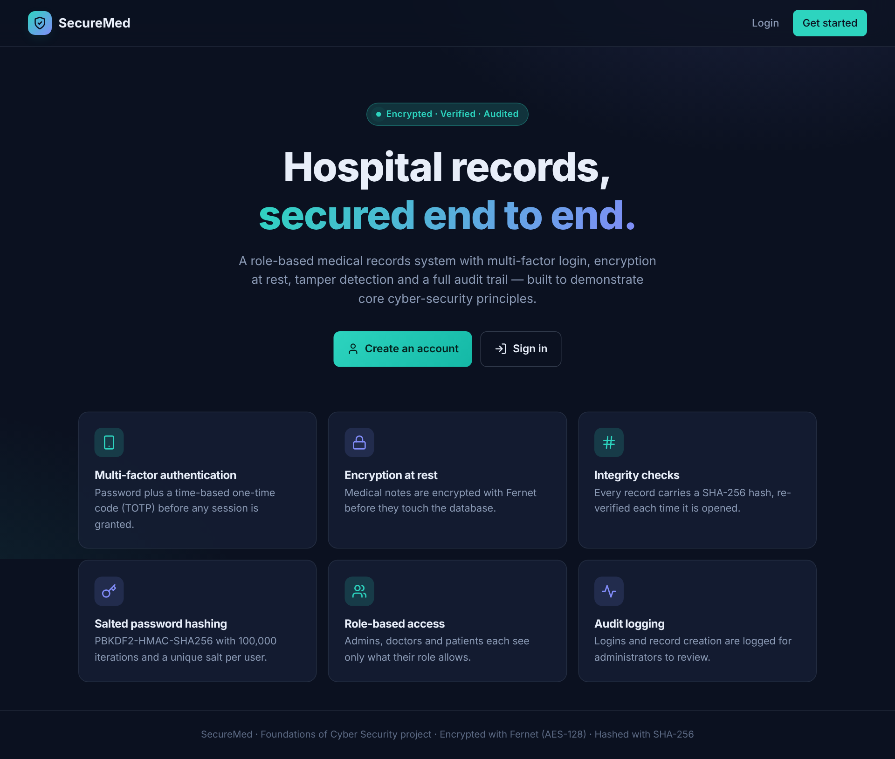
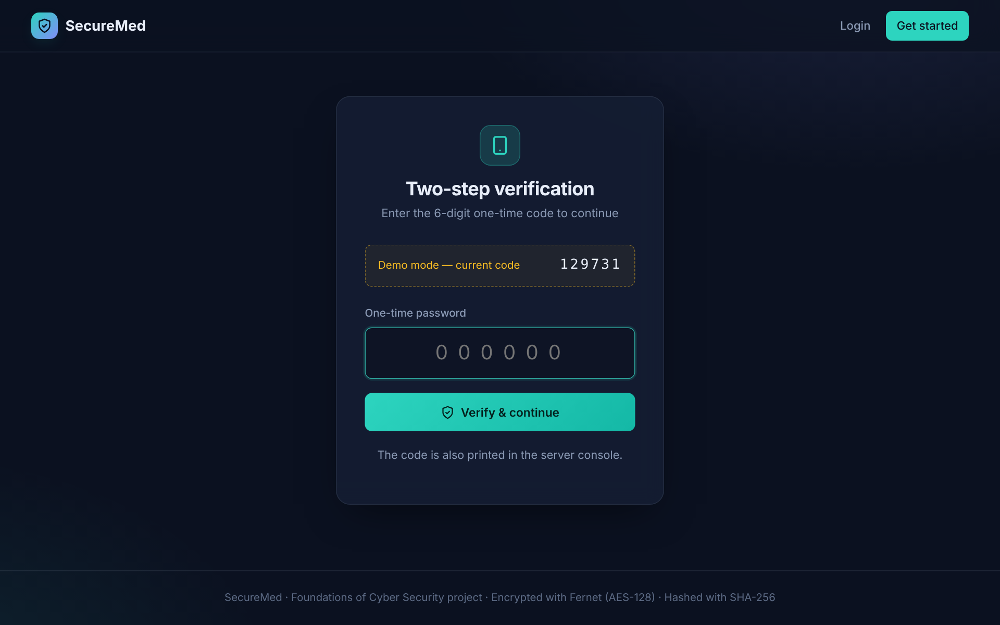
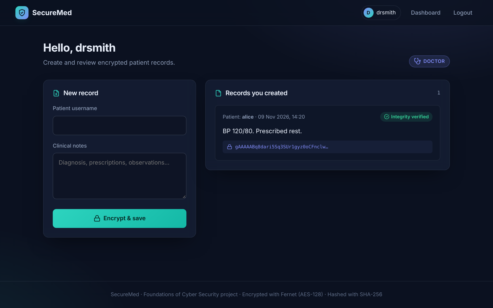
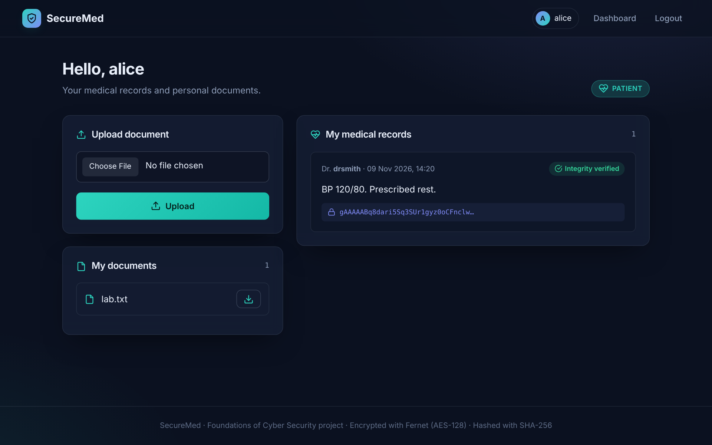
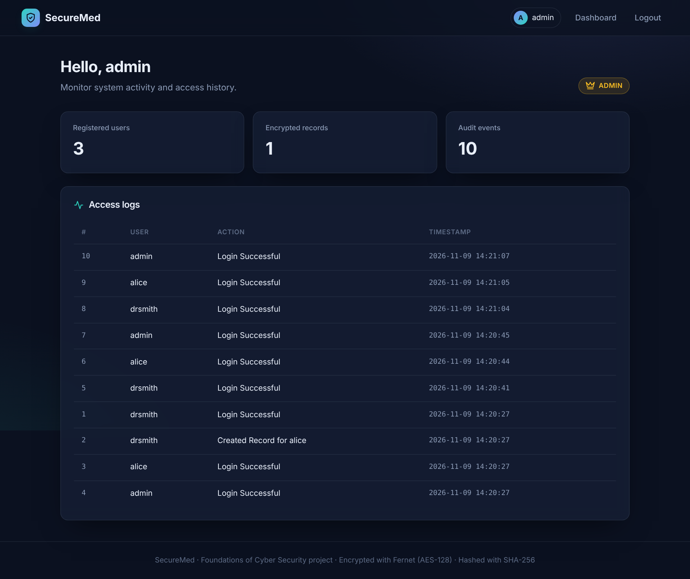
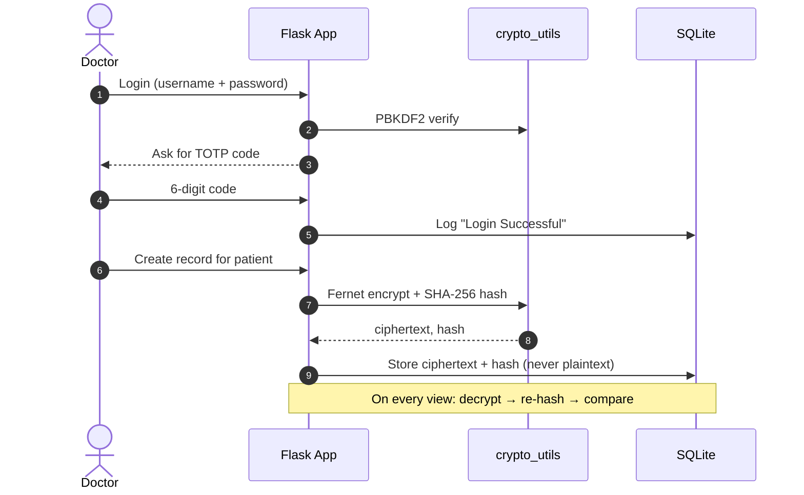

<div align="center">

# 🛡️ SecureMed

### A secure hospital records system built on core cyber-security principles

Multi-factor login · Encryption at rest · Tamper detection · Role-based access · Audit trail




</div>

---

## 📖 About

**SecureMed** is a Foundations of Cyber Security (FOCS) project: a web app where **doctors** write medical records, **patients** read their own records and store documents, and **admins** audit every action. Each feature maps directly to a security concept — confidentiality, integrity, authentication, authorization and accountability.

## ✨ Features

| Concept | How SecureMed implements it |
|---|---|
| 🔐 **Authentication** | Password + Time-based One-Time Password (TOTP) via `pyotp` |
| 🧂 **Password storage** | PBKDF2-HMAC-SHA256, 100,000 iterations, unique 16-byte salt per user, constant-time comparison |
| 🔒 **Confidentiality** | Medical notes encrypted with **Fernet** (AES-128-CBC + HMAC) before they reach the database |
| 🧾 **Integrity** | SHA-256 hash stored with every record and re-verified on every view — tampering is flagged |
| 👥 **Authorization** | Role-Based Access Control: **Admin**, **Doctor**, **Patient**, enforced by route decorators |
| 📜 **Accountability** | Access log of logins and record creation, visible to admins |
| 📎 **Encoding** | Patient uploads stored Base64-encoded, downloadable by the owner only |

## 📸 Screenshots

| Two-step verification | Doctor dashboard |
|:---:|:---:|
|  |  |
| **Patient dashboard** | **Admin audit log** |
|  |  |

## 🏗️ How it works



## 🛠️ Tech Stack

- **Backend:** Python, Flask, Flask-SQLAlchemy
- **Database:** SQLite
- **Security:** `cryptography` (Fernet, PBKDF2), `pyotp` (TOTP), `hashlib` (SHA-256), `werkzeug` (safe filenames)
- **Frontend:** Jinja2 templates, hand-written CSS (no framework), inline SVG icons

## 📂 Project Structure

```
FOCS/
├── app.py               # Flask routes, RBAC decorators, MFA flow
├── database.py          # SQLAlchemy models (User, MedicalRecord, AccessLog, Document)
├── crypto_utils.py      # Encryption, hashing & password helpers
├── requirements.txt
├── .env.example         # Configuration template
├── templates/
│   ├── base.html        # Layout, navbar, flash messages
│   ├── _icons.html      # SVG icon macros
│   ├── index.html       # Landing page
│   ├── login.html · register.html · otp.html
│   └── dashboard.html   # Role-specific dashboards
├── static/css/style.css
├── docs/screenshots/
├── enc_data/            # master.key is generated here at first run (git-ignored)
└── instance/            # SQLite database is created here (git-ignored)
```

## 🚀 Getting Started

```bash
# 1. Clone
git clone https://github.com/parvathy2907/FOCS.git
cd FOCS

# 2. Create a virtual environment
python3 -m venv venv
source venv/bin/activate        # Windows: venv\Scripts\activate

# 3. Install dependencies
pip install -r requirements.txt

# 4. Run
python3 app.py
```

Open **http://127.0.0.1:5000**. The database and encryption key are created automatically on first run.

### Configuration (optional)

| Variable | Default | Purpose |
|---|---|---|
| `SECRET_KEY` | dev value | Flask session signing key — **set this in production** |
| `ADMIN_PASSWORD` | `admin123` | Password for the auto-created `admin` account |
| `DEMO_MODE` | `1` | Shows the current OTP on the verification page (set `0` to hide) |

## 🧭 Usage

1. **Register** a Doctor and a Patient (or sign in as `admin` / `admin123`).
2. **Log in** → enter the 6-digit code (shown on screen in demo mode, and always printed in the server console).
3. **Doctor:** enter a patient's username and clinical notes → *Encrypt & save*.
4. **Patient:** see your decrypted records with an integrity badge; upload and download documents.
5. **Admin:** review user/record counts and the full access log.

## 🛡️ Security Notes

- The encryption key (`enc_data/master.key`) and the database are **git-ignored** — they must never be committed.
- If the database is leaked, records stay unreadable without the key; changing a single byte of a stored record makes its integrity check fail.
- This is an educational project. For real deployments: store the key in a secrets manager, deliver OTPs through an authenticator app (QR enrolment), add CSRF protection and rate-limit login attempts.

---

<div align="center">
Made with 💙 by <a href="https://github.com/parvathy2907">Parvathy</a>
</div>
